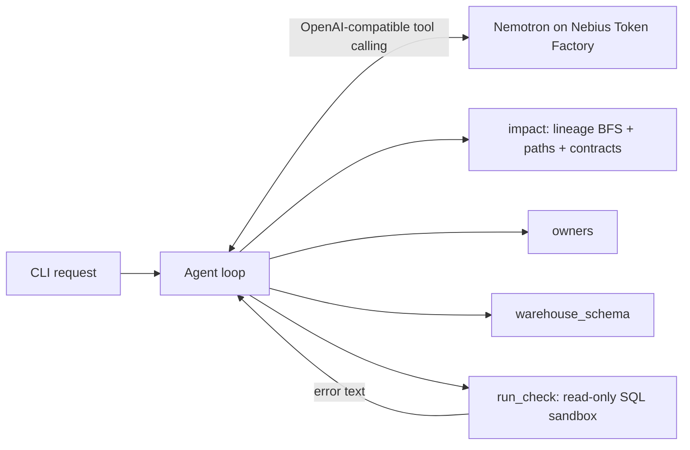

# LineageGate Nemotron

**A coding agent for data teams, powered by NVIDIA Nemotron on Nebius Token Factory.** Tell it about a schema
change. It works out the blast radius from a lineage + contracts graph, **writes SQL contract checks, runs them,
reads the errors and fixes its own SQL**, then tells you whether it's safe to ship and who to notify.

Track: **Coding and Agentic Engineering** · Model: `nvidia/nemotron-3-super-120b-a12b` (configurable) · License: MIT

```
$ lgnemo check stg_orders.amount --change "switch to integer cents"
## Blast radius of column:stg_orders.amount: 36 assets, 3 contracts
- dashboard:finance.revenue_daily  <=  column:stg_orders.amount -> model:stg_orders -> model:fct_orders -> ...
- check `orders_amount_dollars` [contract:orders_amount]: **ERROR** (no such column: amount_usd)
- check `orders_amount_dollars` [contract:orders_amount]: **FAIL** (2 violating rows)
- notify: @priya (on-call), @marcus
```

## How it works



1. `impact` walks column/model/dashboard lineage and returns one explaining path per impacted asset, plus every data contract on those paths.
2. Nemotron reads the contract specs (plain English, e.g. *"amount is decimal(18,2) in USD dollars; not null; >= 0"*) and **writes SQL** that selects violating rows.
3. `run_check` executes it in a **read-only** SQLite warehouse (an authorizer blocks every write, DDL and pragma except `table_info`). Errors go back to the model, which fixes the SQL and retries.
4. Passing/failing checks are saved to `out/checks/*.sql` so you can drop them into CI; the report goes to `out/report.md`.

The synthetic warehouse has two planted defects replaying past incidents (cents-vs-dollars amounts, a duplicated
`customer_id`), so the checks have something real to catch.

## Setup

```bash
git clone https://github.com/nightmoose/lineagegate-nemotron && cd lineagegate-nemotron
python3 -m venv .venv && . .venv/bin/activate && pip install -e . pytest
export NEBIUS_API_KEY=...            # https://tokenfactory.nebius.com -> API keys
lgnemo check stg_orders.amount --change "switch to integer cents"
lgnemo check stg_customers.customer_id --change "merge CRM and Shopify customer ids"
pytest -q                            # 9 tests, no key needed
```

| Env var | Default |
|---|---|
| `NEBIUS_API_KEY` | required for live runs (without it the CLI falls back to `--offline`) |
| `NEBIUS_BASE_URL` | `https://api.tokenfactory.nebius.com/v1` |
| `--provider nvidia\|openrouter\|nebius` | alternate OpenAI-compatible host (default `nebius`); `nvidia` uses `https://integrate.api.nvidia.com/v1` + `NVIDIA_API_KEY`, `openrouter` uses `https://openrouter.ai/api/v1` + `OPENROUTER_API_KEY` (default model `nvidia/nemotron-3-ultra-550b-a55b:free`) |
| `NEMOTRON_MODEL` | `nvidia/nemotron-3-super-120b-a12b` (override with `--model`, e.g. Nemotron 3 Nano or Ultra) |

`--offline` uses a scripted provider that speaks the same tool protocol. It exists for tests and CI only.

## How Nemotron and Token Factory are used

- **Every live run is a runtime call to the Token Factory chat completions API** with Nemotron doing the planning, tool selection and SQL writing.
- Nemotron's tool calling drives the whole loop: it picks tools, turns English contract specs into SQL, and repairs SQL from database error messages.
- Token Factory's OpenAI-compatible endpoint means zero SDK dependencies (stdlib `urllib`) and one flag to swap Nemotron sizes (Nano for fast checks, Super by default, Ultra for large graphs).

## What was built during the hackathon

This repo is new, created on Oct 28, 2026, during the submission period. It reuses the *idea* and the synthetic
"Acme Analytics" lineage dataset (`data/`, MIT, same author) from my earlier project LineageGate (a graph-database Q&A agent).
New in this project:

- The **write → run → repair** coding-agent loop and the `run_check` tool with a read-only SQL sandbox
- A synthetic SQLite warehouse generated from the column catalog, with planted defects
- A dependency-free in-memory lineage engine (no graph database needed)
- The Nebius Token Factory / Nemotron provider, CLI, CI-ready check export, and test suite

## License

MIT
